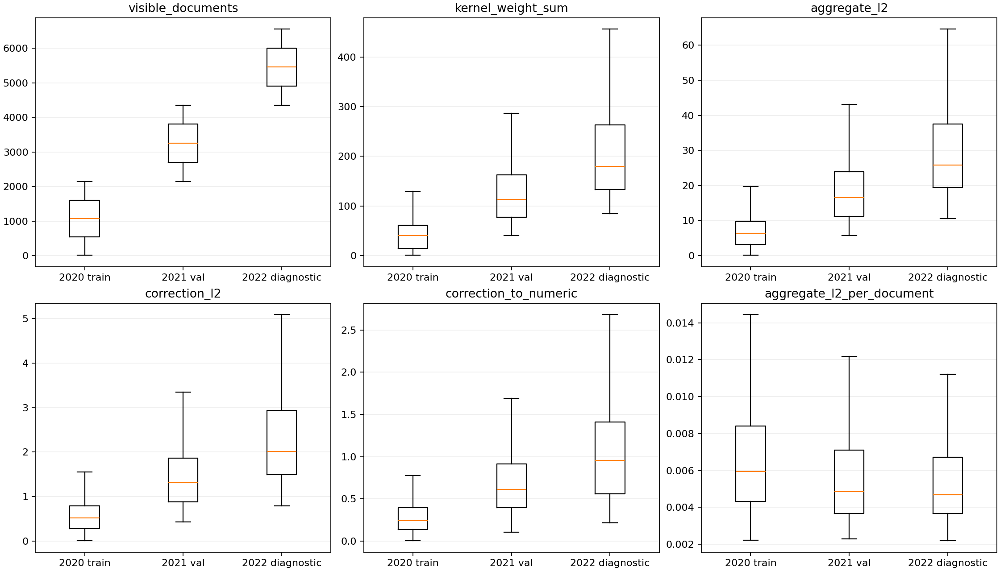
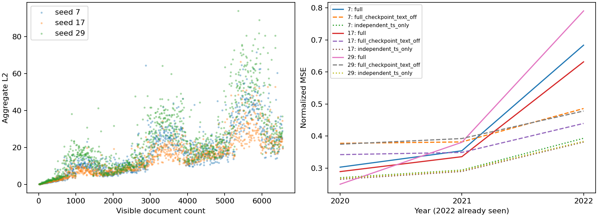
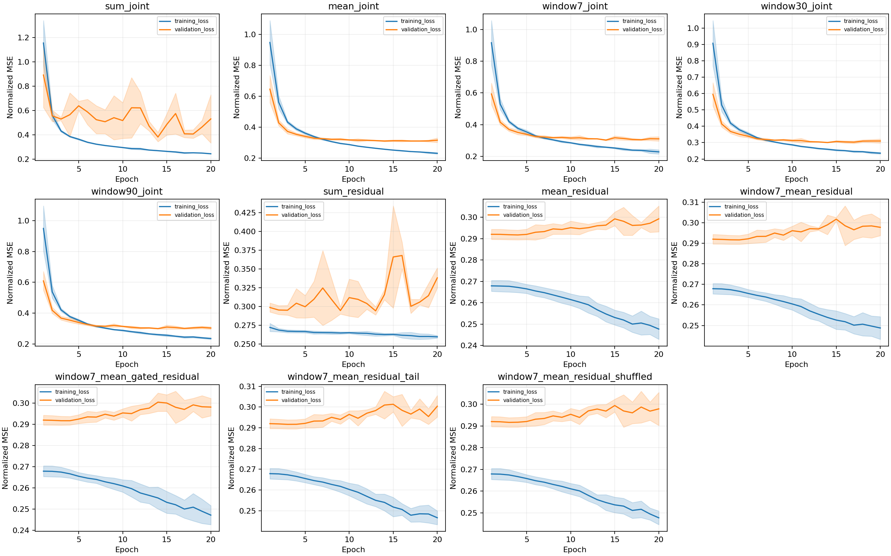
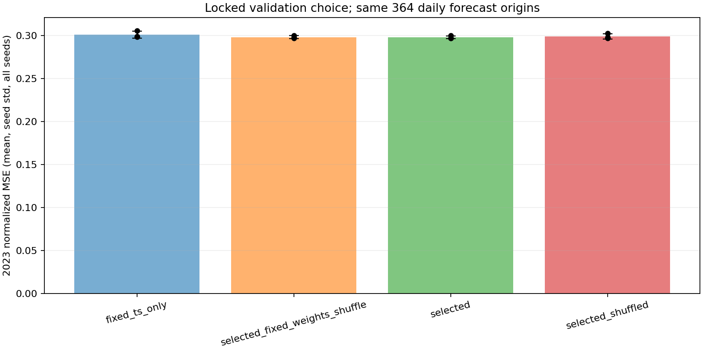

# CITRA 预测退化诊断（2026-10-28）

本轮先在未修改模型的前提下审计现有冻结checkpoint，再进行最小受控修正。
初始基线提交为 `17a1d95`，用户的prompt.md保留。2022年已经被查看，明确只作为诊断集，
不得当作未接触的设计选择外测试集。原始历史可用性仍为显式假设，未升级为verified。

## 改模型之前的冻结审计

实际审计Linear/DLinear各3种种子（7/17/29）的Full checkpoint，并分别加载同种子的独立TS-only。
每个checkpoint覆盖361个2020训练、363个2021验证、363个2022诊断起点。
保存逐窗口可见N、核权重和/均值/最大值、聚合L2、修正L2、数值预测L2、修正/数值比例、
按N归一后的范数，逐目标MSE/MAE/预测偏差，以及查询坐标的年度均值/标准差。
这是最终拟合模型的回顾性分布分析；训练年份预测不是在线样本外性能。

初始数值证据（Linear，逐年均值；括号内为seed7/17/29）：

|量|2020训练|2021验证|2022已见诊断|
|---|---|---|---|
|可见文档N|1072.93|3256.85|5456.60|
|核权重和|45.37 / 32.05 / 47.05|140.33 / 95.05 / 140.03|229.01 / 162.88 / 232.96|
|聚合L2|6.58 / 5.44 / 9.67|18.15 / 14.68 / 23.04|29.02 / 24.82 / 36.94|
|文本修正L2|0.53 / 0.46 / 0.78|1.40 / 1.23 / 1.74|2.22 / 2.07 / 2.73|
|修正/数值范数|0.270 / 0.250 / 0.406|0.709 / 0.660 / 0.875|1.040 / 1.027 / 1.302|

Linear中N与核权重和相关0.760–0.852、与修正L2相关0.674–0.834。
这支持累计文档驱动的尺度漂移假设，但相关性不能单独证明全部误差来自N。
原实现是未归一完整核和；归一化query/key在sigma=.7时RBF权重理论下限约exp(-4/.98)=.01688，
没有时间衰减/失效的历史文档不会自然被核完全消除，正权重质量随N有增长下限。
带符号影响仍可相互抵消，所以不能仅由N推导修正范数必然线性增长。

关闭文本也不能恢复独立TS-only：2022 Linear三个种子的原Full数值分支MSE为
0.48586 / 0.43936 / 0.47810，独立TS-only为0.39305 / 0.38123 / 0.38346；
添加原文本后进一步变为0.68337 / 0.63138 / 0.79022。
原Full的数值分支本身已较差，不能把所有损失归为推理时单独加了一个过大的修正。
联合优化中的梯度竞争/优化预算是否为原因，仍需冻结Backbone的受控实验；现有日志没有逐模块梯度，不能声称已证明。

完整数值与审计时原代码SHA在
[diagnosis.json](../artifacts/citra_failure_diagnosis/audit_frozen/diagnosis.json)，
逐窗口数据在[windows.csv](../artifacts/citra_failure_diagnosis/audit_frozen/windows.csv)。
图在模型修改之前生成，审计代码哈希与原始HEAD的Git blob逐一核对一致。
分布图将三个种子的窗口合并展示，不将同一窗口的三个种子当作独立天气样本：





原Full的Linear三种子平均物理偏差从2020年的温度+0.614°F、风速+0.492knots，
转为2021年的−2.134°F/−0.990knots，再到2022年的−5.461°F/−3.129knots。
不能把该偏差自动解释为真实事件变化的因果影响；它与累计修正漂移一致。

## 独立定义的聚合算子与最小修正

令D(t)为原始版本规则下在t合法可见的文档集合，A(d)为显式协议定义的公开可用时刻。
所有方案沿用同一数值观测、48→6小时任务、UTC每日起点、+1小时数值可用性假设、
文本发行+0小时假设。没有用事件时间代替公开时间，没有放宽原来的版本/未知来源规则。

- 原Full Sum：对D(t)全部合法文本做完整RBF核和，保留默认行为、原checkpoint和历史结果。
- Count Mean：同一完整核和除以max(|D(t)|,1)，不是除以核权重总和，也不是softmax。
- Window Sum：定义D_W(t)={d∈D(t):t−W<A(d)≤t}，W固定为7/30/90天；
  窗口之外的文本不参与该算子的Exact参照，不拿它与全历史Sum冒充同一预测函数。
- 固定骨干残差：从同种子已训练TS-only复制数值骨干、冻结其全部参数，文本线性头零初始化，
  初始预测严格等于原TS。额外20epoch只优化文本分支；记录并验证训练前后数值骨干逐参数完全相等。
- 历史门控：g(x)=sigmoid(aᵀvec(x)+b)，标量范围[0,1]，只读预测起点之前的数值历史；
  不读聚合结果或未来标签。增加97个参数，不将其改善自动归为文本价值。

预先固定了11个低成本配置，每个3种种子，包括全历史Sum/Mean、7/30/90天Sum、
Sum/Mean残差、7天Mean残差、有界门控、同预算末尾文本截断、因果打乱。
只增加一个尾部截断对照：冻结同一MiniLM，头段按原方式截断，尾段取最后254个wordpieces解码后重新编码，二者编码上限均256，
不改变文档身份或可用时刻；没有按测试结果选取段落。尾段只用于一组7天Mean残差对照，未穷举分段组合。

原Sum三个checkpoint复用，新增训练30个模型；全部20epoch、相同AdamW/批量/剪裁配置。
残差方案复用此前TS的20epoch预训练，不能把它与joint的20epoch说成相同的端到端总预算；
归因主要依靠同一固定骨干的text-off、重训打乱控制和固定权重打乱，而非只比较joint/residual的名次。
新增日志保存全局梯度范数与剪裁比例：7天Mean残差三个种子均为0剪裁，window7 joint为27.5%/25.0%/37.5%。
这提示优化状态不同，但没有逐模块梯度或单独固定学习预算消融，不能把梯度竞争写成已证明的唯一原因。

独立Exact Oracle在`citra/learning/aggregation.py`：用原始snapshot/版本选择，再按同一公开窗口过滤，
逐文档补偿求和；训练/向量化评估使用另一路mask与矩阵计算。
每种语义均有fixture与真实查询的Exact/Approx回归。

## 验证集选择、稳定性和已见2022诊断

配置在运行新实验前登记于`configs/citra_failure.yaml`和
[registration.json](../artifacts/citra_failure_diagnosis/experiments/registration.json)。
2020训练、2021验证；每种种子固定361/363个起点；标准化只拟合2020期内已可用的观测。
所有设计只按**三种种子的2021验证MSE均值**选择，所有配置训练/验证完成后才写入
[selection.json](../artifacts/citra_failure_diagnosis/experiments/selection.json)。
写入选择之前，本轮消融脚本没有计算2022或2023指标；原2022结果明确已经被查看，不能恢复为未见测试集。
选出后才评价2022诊断和2023保留年份，不根据它们重新选择门控/窗口/表示。

标准化联合MSE，均值±样本标准差（种子7/17/29全部保留）：

|配置|2021验证|2022已见诊断|
|---|---:|---:|
|独立TS-only（固定参照）|0.292051 ± 0.002280|0.385913 ± 0.006282|
|原Sum joint|0.356759 ± 0.022579|0.701655 ± 0.080980|
|Count Mean joint|0.306683 ± 0.002781|0.399084 ± 0.007971|
|Window7 Sum joint|0.301072 ± 0.002451|0.398076 ± 0.008800|
|Window30 Sum joint|0.298560 ± 0.001781|0.393891 ± 0.007092|
|Window90 Sum joint|0.298096 ± 0.003308|0.402758 ± 0.010713|
|Sum residual|0.291527 ± 0.001953|0.391795 ± 0.009983|
|Count Mean residual|0.291707 ± 0.002253|0.386482 ± 0.005553|
|Window7 Mean residual（锁定选择）|0.291331 ± 0.001965|0.388290 ± 0.005000|
|Window7 Mean gated residual|0.291548 ± 0.001959|0.385692 ± 0.005826|
|Window7 Mean residual / tail tokens|0.291668 ± 0.002177|0.386307 ± 0.005556|
|Window7 Mean residual / causal shuffle|0.291113 ± 0.001995|0.387813 ± 0.005291|

Mean/有限窗口大幅改善原Sum的退化，但单独改变尺度仍未超过TS-only。冻结残差基本恢复TS水平，
说明保持已训练数值预测是有用的最小保护措施，不能单独归因于更多模型容量。
门控不是验证集最佳，也没有用已见2022中略好的门控结果替换已锁定选择。
尾段没有稳定胜过头段；因果打乱在验证上反而更好，内容收益证据弱。
验证集选中方案在已见2022仍略差于TS，不能隐去这个失败年份。

完整逐种子、逐目标MSE/MAE、偏差与text-off指标在
[summary.json](../artifacts/citra_failure_diagnosis/experiments/summary.json)与
[scores.csv](../artifacts/citra_failure_diagnosis/experiments/scores.csv)。所有配置训练/验证曲线如下，
阴影是种子标准差，不是年份/地区泛化置信区间：



## 新保留年份2023：退化缓解，但文本价值仍未确立

2023的AFD/ASOS在选择前只做下载、哈希/格式/缺失审计和冻结逐文档编码，未计算预测指标。
选择和匹配内容控制锁定后，只评价被选方案、固定TS、同容量重训打乱、固定权重推理打乱。
三种种子均不再拟合或更新2023的Scaler/参数；旧年度数值、可用时间、原始文档、原向量前缀逐元素验证不变。
单独编码2023后追加向量，不重新编码旧文档以引入浮点/表示漂移。

2023原始AFD2207份：1份发行头冲突、同一doc_id的2个无法确定公开顺序的修订整组隔离，保留2204份；
覆盖365天。ASOS原始8761行，有1组冲突时间戳`2023-06-30 10:50`，
在查看预测结果前明确排除该组全部记录，不挑选任一“更正值”。原CSV没有修改，严格默认仍拒绝重复组；
只有显式`--quarantine-numeric-duplicates`按统一规则隔离。
8760×2数值格缺失7格，最终364个合法日频测试起点。
详见[2023 provenance manifest](../artifacts/citra_failure_diagnosis/holdout_manifest.json)。

|2023保留年份|标准化MSE|标准化MAE|
|---|---:|---:|
|固定TS / 残差模型关闭文本|0.301148 ± 0.003939|0.373221 ± 0.004917|
|锁定的Window7 Mean residual|0.298032 ± 0.001625|0.371246 ± 0.003401|
|相同训练权重，推理时因果打乱|0.298193 ± 0.001646|0.371336 ± 0.003422|
|同容量/训练预算，重训因果打乱|0.299019 ± 0.003110|0.371831 ± 0.004270|

三种种子的TS→所选方案MSE依次为0.305684→0.299903、0.298597→0.296983、0.299162→0.297208。
三种种子的text-off数组与原TS预测**逐元素完全相同**。
所选方案比TS平均改善约1.03%，但固定权重打乱仍保留约94.8%的MSE改善；
真实文本相对固定权重打乱的平均优势仅0.0001615，三个种子约0.0001778/0.0000798/0.0002269。
这不是“打乱后收益消失”。重训打乱也改善TS，且seed29重训打乱优于真实文本。
季节元数据、修正偏差、历史数值条件查询及训练随机性仍可能解释大部分收益，不能把1.03%全部归为语义/时间对齐价值。

物理单位逐目标均值±种子标准差：

|2023方法|温度MSE(°F²)|温度MAE(°F)|风速MSE(knot²)|风速MAE(knot)|
|---|---:|---:|---:|---:|
|TS-only|22.5721 ± 1.8859|3.6301 ± 0.1445|12.7116 ± 0.0865|2.7555 ± 0.0175|
|所选残差|22.5460 ± 1.9276|3.6325 ± 0.1486|12.5693 ± 0.0313|2.7360 ± 0.0095|
|固定权重打乱|22.5408 ± 1.9302|3.6319 ± 0.1488|12.5770 ± 0.0331|2.7370 ± 0.0101|
|重训打乱|22.5391 ± 1.9017|3.6302 ± 0.1454|12.6152 ± 0.0445|2.7421 ± 0.0102|

改善主要体现在风速，温度MAE反而略差；单个地区一年不能确立广泛可靠文本增益。
日频MSE改善天数仅约50.5%–51.4%，不得把三个种子的重复天气目标当作三倍独立样本。



## 认证与最低性能回归

最终输出为TS(x)+g(x)·W·S(t)/d(t)，d=max(N,1)或1。
固定查询历史后，g由真实历史和实际门控参数算出，聚合输入的有效Lipschitz上界为
|g(x)|·||W||F；若以未归一核和为输入，则为|g(x)|·||W||F/d(t)。
认证预算和返回的聚合误差界均使用相同d；空集合分母1、修正和余项0。
参数/配置/文本变化均绑定模型与corpus指纹，新会话重新编码和建索引；不复用旧参数索引。
不支持的自定义门控拒绝认证，不发放伪证书。

窗口索引将算子视图中的valid_to裁剪为min(源valid_to,A(d)+W)，源文档不修改；
仍遵循权威版本和失效语义。独立Oracle从原snapshot按相同窗口筛选，防止过期版本复活。
真实查询回归覆盖7种不同算子/门控组合、第一种预注册种子、3个验证截止时刻、
ε∈{0,.01,.1}共63组Exact/Approx/独立Oracle对照，全部满足预算（atol/rtol=1e-10的float64对照，非正式IEEE保证）。
最大实际输出偏差0.0001111，证书只约束相同冻结预测函数的近似差，不约束真实目标误差。
结果在[certificate_regression.json](../artifacts/citra_failure_diagnosis/experiments/certificate_regression.json)。
最终推理路径另复测默认Sum与有门控的窗口Mean，并确认三种种子的原Sum预测与旧产物逐元素完全相同，
见[最终推理核对与代码哈希](../artifacts/citra_failure_diagnosis/final_inference_regression.json)。
未启用门控的默认路径不执行门控编码或额外GPU门控同步。

75项测试通过：保留原67项并新增8项语义测试，包含可见文档数分母、公开窗口边界/微秒、
独立Oracle、真实门控范数、门控变更失效、自定义门控拒绝、零头/冻结骨干、空窗口和数值冲突整组隔离。
[测试日志](../artifacts/citra_failure_diagnosis/tests.txt)。
旧Full Scan/向量化Full/CITRA-AVL的所有性能产物不变，仍见
[上轮性能记录](citra_realdata_readiness.md)。本轮只有语义/证书回归，不以建树与Oracle诊断时间冒充新速度基准。

## 判断和停止条件

- **已经排除/解决**：不能把“推理时关文本”误当独立TS基线；原数值分支退化已被独立对照证实。
  窗口/归一化都有独立完整参照；零头残差初始和关闭文本都严格回到固定TS；参数变化会使旧索引失效。
  合法窗口不随模型变化，Scaler只用训练期，2023未参与选择，所有种子和负年份均报告。
- **主要支持的解释**：全历史未归一核质量/修正随N漂移；联合拟合的数值分支比独立TS弱。
  控制显示这些问题可以通过限窗、定分母和保护数值骨干缓解，不能把尺度漂移当作唯一原因。
- **仍未解决**：历史首次公开时间认证、修订传播真值、充分优化预算对照、季节元数据/偏差校准/语义各自贡献、
  窗口与编码分段的跨地区稳定性、单一年份统计显著性。未做大模型、多地区、Hybrid或ICDE创新包装。
- **数据库算子候选**：优先保留“公开时间有界窗口+合法可见计数归一”的核和，而非全历史无界Sum。
  它提供明确as-of/版本/窗口/分母语义，修正尺度更稳定，能调整认证界；7天只是本轮验证选择，不能推广为普适最佳窗口。
- **Go/No-Go**：对复杂CITRA索引与Hybrid开发给出 **No-Go**。退化已显著缓解且2023有小幅预测改善，
  但打乱未消除大部分收益、已见2022仍失败，旧索引也无加速；不足以支持新数据库索引研究的系统投入。
  只保留算子与最小残差修正作为以后复核的候选，本轮到此停止，不进入Hybrid。

## 成本、复现和失败记录

主消融阶段墙钟266.39秒（30个新增训练、3个原Full复用，包含训练/验证评价），
保留年份43.40秒、已见年份+认证91.17秒；后两个阶段曾并行，不能直接相加冒充端到端墙钟。
残差还复用此前3份TS训练成本，模型/日志引用原checkpoint，不把它算成免费新增训练。
首段2023追加编码4.496秒（2204份文本），尾段编码8.800秒、尾段预处理21.708秒（6562份），
两个任务的基础模型加载分别为3.834/3.792秒，
时间独立记录在各特征manifest；基础模型/绘图依赖下载及失败重试不计入训练时间。
本机绘图依赖隔离下载约数分钟，公开归档下载也有等待；没有隐藏为索引/模型速度。

实际遇到并解决：首次审计用int0与原float0.0产生不必要指纹不等，统一延迟标量为float后与原checkpoint匹配；
Matplotlib起初未安装，先保留完整数值审计，再安装隔离依赖生成图；2023默认收集因冲突观测拒绝，
显式整组隔离后通过；汇总初版split关键字重复已修复，重新汇总不影响模型或选择。
原始错误不当作数据/研究成功，失败尝试的文件未覆盖历史产物。

正常环境安装`requirements-citra.txt`、`requirements-citra-text.txt`、`requirements-citra-diagnosis.txt`。
本机使用Python3.10/NumPy2.2.5/PyTorch2.4.1/CUDA12.1/A100，过程级
`LD_PRELOAD=/tmp/citra-ittapi/libjitprofiling.so`，绘图`PYTHONPATH=/tmp/citra-diagnosis-plots`，
编码`PYTHONPATH=/tmp/citra-textdeps:/tmp/citra-encoder-minimal`；兼容库固定提交和构建见历史进度。

```bash
# 原模型审计必须在修改模型之前执行；本次已执行并保存原代码哈希
python scripts/diagnose_citra_scale.py --output /tmp/citra-frozen-audit --device cuda:0
# 新数据只追加2023，2020–2022下载与MiniLM特征沿用上轮产物
python scripts/download_nws_afd.py --office DMX --server mesonet3.agron.iastate.edu \
  --start 2023-01-01T00:00Z --end 2024-01-01T00:00Z --output dataset/citra_real_dsm/raw/AFDDMX_2023.zip
python scripts/download_asos.py --station DSM --server mesonet3.agron.iastate.edu \
  --start 2023-01-01T00:00Z --end 2024-01-01T00:00Z --output dataset/citra_real_dsm/raw/DSM_2023.csv
python scripts/build_citra_multiyear.py collect --raw dataset/citra_real_dsm/raw --years 2020 2021 2022 2023 \
  --protocol issuance_asof_assumption --numeric-delay-hours 1 --quarantine-numeric-duplicates \
  --output dataset/citra_real_dsm/collection_2023
python scripts/encode_citra_text.py --documents dataset/citra_real_dsm/collection/documents.jsonl \
  --output dataset/citra_real_dsm/minilm_tail --revision 1110a243fdf4706b3f48f1d95db1a4f5529b4d41 \
  --text-strategy tail --max-length 256 --device cuda:0
python scripts/build_citra_multiyear.py prepare --collection dataset/citra_real_dsm/collection \
  --features dataset/citra_real_dsm/minilm_tail --output dataset/citra_real_dsm/prepared_tail
python - <<'PY'
import json
from pathlib import Path
from data_provider.citra_weather import load_jsonl
p = Path('dataset/citra_real_dsm')
old = load_jsonl(p / 'collection/documents.jsonl')
extended = load_jsonl(p / 'collection_2023/documents.jsonl')
assert old == extended[:len(old)]
(p / 'documents_2023.jsonl').write_text(''.join(json.dumps(r) + '\n' for r in extended[len(old):]))
PY
python scripts/encode_citra_text.py --documents dataset/citra_real_dsm/documents_2023.jsonl \
  --output dataset/citra_real_dsm/minilm_2023 --revision 1110a243fdf4706b3f48f1d95db1a4f5529b4d41 \
  --max-length 256 --device cuda:0
python scripts/append_citra_features.py --old-records dataset/citra_real_dsm/collection/documents.jsonl \
  --new-records dataset/citra_real_dsm/documents_2023.jsonl --old-features dataset/citra_real_dsm/minilm \
  --new-features dataset/citra_real_dsm/minilm_2023 --output dataset/citra_real_dsm/minilm_extended
python scripts/build_citra_multiyear.py prepare --collection dataset/citra_real_dsm/collection_2023 \
  --features dataset/citra_real_dsm/minilm_extended --output dataset/citra_real_dsm/prepared_2023
python scripts/run_citra_failure_ablation.py train --device cuda:0
python scripts/run_citra_failure_ablation.py heldout --device cuda:0
python scripts/run_citra_failure_ablation.py diagnostic --device cuda:0
python scripts/report_citra_failure.py
python -m unittest discover -s tests -v
```

输出目录已存在时准备/编码拒绝覆盖；重跑实验用新`--output`目录，训练阶段可跳过同注册配置已完成结果。
训练、选择、保留年份、已见年份分成不同命令，无法在没有selection锁文件时运行最终评价。
完整配置、模型、逐种子训练/验证日志、预测数组、目标、cutoff和报告位于`artifacts/citra_failure_diagnosis/`，
原始/向量文件仍在被Git忽略的`dataset/citra_real_dsm/`，全部旧产物和用户prompt修改保留，未提交/推送。

修改文件按功能分组：模型`models/CITRA.py`及`citra/learning/{aggregation,gating,training,inference,diagnostics}.py`；
数据`data_provider/citra_weather.py`、`scripts/{prepare_citra_weather,build_citra_multiyear,encode_citra_text,append_citra_features}.py`；
评估`exp/exp_CITRA.py`、`scripts/{diagnose_citra_scale,run_citra_failure_ablation,report_citra_failure}.py`；
配置/检查`configs/citra_failure.yaml`、`requirements-citra-diagnosis.txt`、`tests/test_citra_aggregation_semantics.py`；
本报告、README、进度及新增artifacts。NumPy认证和AVL数据结构没有修改。
