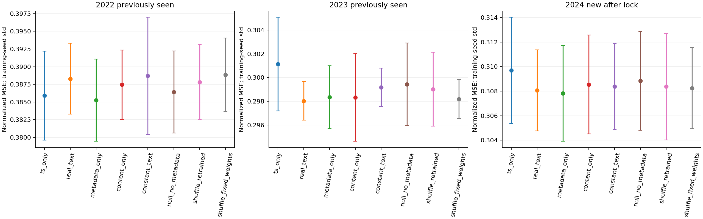
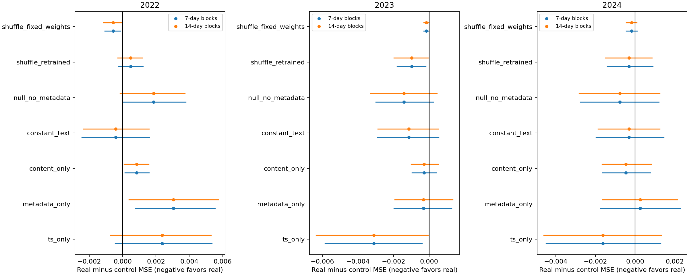

# CITRA 最终文本信息价值诊断（2026-10-29）

**Prediction: Evidence Insufficient / No-Go for the independent semantic claim。**
真实文本的总残差模型有小幅点估计改善，但不能稳定超过无语义的元数据、常量和打乱控制。
不能把相对TS的改善直接命名为文本语义收益。

## 固定协议和输入控制

所有新增方案在任何新结果前登记：同一seed7/17/29预训练TS、完全冻结骨干、文本头零初始化、
Window7 Count Mean、48→6小时、相同2020训练和2021最佳epoch验证、AdamW/20epoch/batch32/lr=.001/梯度限制1。
原真实文本和重训打乱的各3份checkpoint复用，固定权重打乱不重训。
新增Metadata-only、Content-only、Constant Text、Null/no metadata共12个训练。
内容消融的文本残差模型均20,620参数，骨干1,164固定，19,456可训练；TS-only只执行该骨干。
常量输入会缩小有效函数空间、部分输入权重无梯度，
这是控制本身的必要差异，不能把相同分配参数量说成完全相同有效容量。

|方案|实际输入|
|---|---|
|真实文本|原冻结MiniLM384维 + 发行月份sin/cos|
|Metadata-only|384维全0；只保留发行月份sin/cos，无文本/embedding访问|
|Content-only|原MiniLM；Impact Encoder的两项月份元数据固定0|
|Constant Text|所有文档同一固定单位基向量；保留月份sin/cos|
|Null/no metadata|所有embedding和月份都0，仍用同一历史条件query与残差网络|
|固定权重因果打乱|真实模型参数不变，内容从时槽激活前合法供体中前缀有放回采样|
|同容量重训打乱|同样的因果供体规则，使用已有同预算重训权重|
|Text-off / TS-only|完全关闭修正，每种种子的数值预测与原TS逐元素相同|

没有加入未登记的公开时间位置/N特征。合法集合和计数归一分母本身保留时间/集合结构；
常量Key/Impact在非空窗口的计数归一会抵消N，因此Null主要是历史数值条件的额外校准函数。
Query Encoder仍可读取历史数值、已知目标与horizon；不能把由此产生的季节信息称作“纯文本”。
Content-only只删除直接月份sin/cos，MiniLM本身可能编码原始发行头/文本中的日期或季节词，未宣称消除了所有隐式季节信息。
非内容控制通过字段白名单构造输入，测试会使控制构造阶段任何原embedding/text访问抛错；不会把真实内容送入网络或用其统计量生成非内容输入。
“无内容访问”指该特征/模型路径，不声称来源审计和原始JSON加载在IO层面从未读取包含内容的文件字节；来源fingerprint只绑定产物，不作为模型特征或随机种子。
因果替换供体均不晚于原时槽激活，原时槽在查询截止前合法才可参与；没有全局未来池置换。

## 年份角色与新独立检验

2020训练、2021验证；2022/2023此前已查看，本轮只做解释性诊断。
本轮注册后下载2024，同站/办公室、相同协议，全部方法权重冻结后才计算2024预测指标。
2024没有调窗口、网络、超参、表示或挑选种子；这是新年份验证，但仍只有一个地区，也不是获证历史到达回测。
2024原始AFD2228份，5份发行头冲突隔离，保留2223份；ASOS8784行，无重复时间组，风速缺失3格；
旧数值、时间可用性、原文身份和旧向量前缀保持，Scaler仅2020拟合。各年共同起点数为363/364/366。
[注册/环境](../artifacts/citra_final_diagnosis/registration.json)、[新年份provenance](../artifacts/citra_final_diagnosis/new_year_manifest.json)、
[全部方法冻结记录](../artifacts/citra_final_diagnosis/semantics/methods_frozen.json)。

## 全部种子与逐目标结果

以下标准化MSE为三种训练种子均值±样本标准差，不能将同一天气目标当作3份独立观测。
|方案|2022|2023|2024|
|---|---|---|---|
|ts_only|0.385913 ± 0.006282|0.301148 ± 0.003939|0.309695 ± 0.004331|
|real_text|0.388290 ± 0.005000|0.298032 ± 0.001625|0.308067 ± 0.003310|
|metadata_only|0.385246 ± 0.005801|0.298352 ± 0.002658|0.307816 ± 0.003909|
|content_only|0.387449 ± 0.004895|0.298318 ± 0.003687|0.308539 ± 0.004029|
|constant_text|0.388710 ± 0.008286|0.299174 ± 0.001609|0.308377 ± 0.003504|
|null_no_metadata|0.386427 ± 0.005790|0.299441 ± 0.003482|0.308837 ± 0.004033|
|shuffle_fixed_weights|0.388856 ± 0.005188|0.298193 ± 0.001646|0.308240 ± 0.003299|
|shuffle_retrained|0.387813 ± 0.005291|0.299019 ± 0.003110|0.308369 ± 0.004331|

标准化MAE：
|方案|2022|2023|2024|
|---|---|---|---|
|ts_only|0.408828 ± 0.006642|0.373221 ± 0.004917|0.375774 ± 0.004347|
|real_text|0.409295 ± 0.005802|0.371246 ± 0.003401|0.374820 ± 0.004020|
|metadata_only|0.408094 ± 0.006518|0.371005 ± 0.004185|0.374587 ± 0.004276|
|content_only|0.409262 ± 0.006556|0.371666 ± 0.004782|0.375203 ± 0.004777|
|constant_text|0.408520 ± 0.006634|0.371421 ± 0.003062|0.374595 ± 0.003526|
|null_no_metadata|0.408761 ± 0.006637|0.372170 ± 0.004638|0.375159 ± 0.004654|
|shuffle_fixed_weights|0.409455 ± 0.005654|0.371336 ± 0.003422|0.374778 ± 0.004129|
|shuffle_retrained|0.409136 ± 0.006105|0.371831 ± 0.004270|0.374783 ± 0.004726|

2024每一种子标准化MSE（不只展示最优种子）：
|方案|seed7|seed17|seed29|
|---|---|---|---|
|ts_only|0.314595373|0.308114418|0.306376586|
|real_text|0.311651010|0.307424127|0.305125098|
|metadata_only|0.311799942|0.307661318|0.303985671|
|content_only|0.312906839|0.307740008|0.304968887|
|constant_text|0.312203828|0.307600296|0.305325673|
|null_no_metadata|0.313225199|0.307994941|0.305292157|
|shuffle_fixed_weights|0.311813635|0.307593197|0.305312059|
|shuffle_retrained|0.312951010|0.307813501|0.304341652|

2022逐目标物理单位指标（均值±种子标准差）：
|方案|温度MSE °F²|温度MAE °F|风速MSE knot²|风速MAE knot|
|---|---|---|---|---|
|ts_only|32.529943 ± 3.279370|4.270107 ± 0.212119|16.101679 ± 0.138414|2.951296 ± 0.015414|
|real_text|32.589338 ± 3.266435|4.279671 ± 0.215157|16.208185 ± 0.187297|2.953605 ± 0.006591|
|metadata_only|32.426503 ± 3.288217|4.262852 ± 0.215339|16.076280 ± 0.113019|2.945911 ± 0.014132|
|content_only|32.638837 ± 3.307760|4.287965 ± 0.224094|16.166830 ± 0.124631|2.951388 ± 0.012213|
|constant_text|32.464450 ± 3.222855|4.264975 ± 0.210141|16.234062 ± 0.247040|2.949515 ± 0.015974|
|null_no_metadata|32.502334 ± 3.244320|4.272600 ± 0.218122|16.126821 ± 0.143518|2.950089 ± 0.014078|
|shuffle_fixed_weights|32.577754 ± 3.269857|4.278520 ± 0.215424|16.234884 ± 0.217132|2.955399 ± 0.005312|
|shuffle_retrained|32.555439 ± 3.265909|4.275143 ± 0.213847|16.187977 ± 0.177530|2.953111 ± 0.009794|

2023逐目标物理单位指标（均值±种子标准差）：
|方案|温度MSE °F²|温度MAE °F|风速MSE knot²|风速MAE knot|
|---|---|---|---|---|
|ts_only|22.572148 ± 1.885870|3.630098 ± 0.144453|12.711623 ± 0.086519|2.755483 ± 0.017509|
|real_text|22.546033 ± 1.927597|3.632474 ± 0.148561|12.569274 ± 0.031339|2.735972 ± 0.009489|
|metadata_only|22.465124 ± 1.903184|3.620917 ± 0.147230|12.588277 ± 0.028349|2.736293 ± 0.006872|
|content_only|22.573518 ± 1.991635|3.640287 ± 0.157051|12.581039 ± 0.068682|2.738219 ± 0.011304|
|constant_text|22.422335 ± 1.833124|3.619226 ± 0.139374|12.628435 ± 0.061503|2.740674 ± 0.010821|
|null_no_metadata|22.506382 ± 1.925807|3.630446 ± 0.151666|12.636339 ± 0.061733|2.745309 ± 0.010970|
|shuffle_fixed_weights|22.540787 ± 1.930229|3.631870 ± 0.148820|12.576996 ± 0.033120|2.736974 ± 0.010124|
|shuffle_retrained|22.539089 ± 1.901660|3.630197 ± 0.145445|12.615159 ± 0.044529|2.742106 ± 0.010177|

2024逐目标物理单位指标（均值±种子标准差）：
|方案|温度MSE °F²|温度MAE °F|风速MSE knot²|风速MAE knot|
|---|---|---|---|---|
|ts_only|23.558598 ± 2.066862|3.727488 ± 0.173113|13.054404 ± 0.098355|2.757761 ± 0.003627|
|real_text|23.620653 ± 2.084852|3.734665 ± 0.177938|12.976052 ± 0.060563|2.746961 ± 0.007691|
|metadata_only|23.484306 ± 2.084299|3.720033 ± 0.177725|12.971582 ± 0.097273|2.748063 ± 0.008748|
|content_only|23.674629 ± 2.163465|3.745281 ± 0.191364|12.994998 ± 0.085071|2.748212 ± 0.008606|
|constant_text|23.450597 ± 1.924813|3.717640 ± 0.161809|12.999211 ± 0.074812|2.748688 ± 0.007636|
|null_no_metadata|23.524872 ± 2.107649|3.730761 ± 0.185171|13.016591 ± 0.090879|2.751106 ± 0.008638|
|shuffle_fixed_weights|23.610885 ± 2.086353|3.733442 ± 0.178059|12.984535 ± 0.060422|2.746831 ± 0.008536|
|shuffle_retrained|23.573523 ± 2.094719|3.729864 ± 0.177719|12.992437 ± 0.107977|2.747696 ± 0.011306|

逐种子全部目标指标在[per_seed_metrics.csv](../artifacts/citra_final_diagnosis/semantics/per_seed_metrics.csv)，
逐预测日期MSE/MAE、物理偏差、修正L2和数值L2在[daily_losses.csv](../artifacts/citra_final_diagnosis/semantics/daily_losses.csv)，
原预测、truth、cutoff、门控和N在各模型目录NPZ；新训练曲线保存在原fit日志，没有只保存最佳一次。
修正幅度和偏差汇总在[summary.json](../artifacts/citra_final_diagnosis/semantics/summary.json)，所有Text-off数组均通过与固定TS的逐元素核对。

## 配对时间相关性分析

预注册固定7/14**日历日**循环移动块、2000次、固定种子54321+年份。
先在每个日期对三种训练种子的配对损失差求平均，再沿日历块重采样；缺失日期保留NaN并在块均值中忽略。
没有把3×366行当作1098份独立天气。下面Δ=真实文本−对照，负值才有利于真实文本。
CI是未做多重比较校正的percentile区间，条件于这3份已训练模型；种子不确定性另列标准差，
块长不能排除所有更长时序相关、季节非平稳性和单地区偏差，不能解释为地理泛化置信区间。

2022标准化配对MSE：
|对照|ΔMSE|7天块95%CI|14天块95%CI|改善日期比例|
|---|---|---|---|---|
|ts_only|+0.0023765|[-0.0004571, +0.0053558]|[-0.0007319, +0.0053096]|45.7%|
|metadata_only|+0.0030442|[+0.0007783, +0.0055382]|[+0.0003748, +0.0057301]|48.8%|
|content_only|+0.0008407|[+0.0001433, +0.0015769]|[+0.0000925, +0.0015596]|46.0%|
|constant_text|-0.0004199|[-0.0024537, +0.0016063]|[-0.0023437, +0.0015840]|49.3%|
|null_no_metadata|+0.0018626|[+0.0000139, +0.0037897]|[-0.0001578, +0.0037283]|44.9%|
|shuffle_fixed_weights|-0.0005658|[-0.0010633, -0.0001460]|[-0.0011534, -0.0000650]|51.2%|
|shuffle_retrained|+0.0004765|[-0.0002354, +0.0012289]|[-0.0002877, +0.0011834]|45.7%|

2023标准化配对MSE：
|对照|ΔMSE|7天块95%CI|14天块95%CI|改善日期比例|
|---|---|---|---|---|
|ts_only|-0.0031161|[-0.0058573, -0.0003936]|[-0.0063494, -0.0000577]|51.6%|
|metadata_only|-0.0003205|[-0.0019760, +0.0012588]|[-0.0019331, +0.0013218]|46.2%|
|content_only|-0.0002862|[-0.0009571, +0.0003854]|[-0.0010091, +0.0005201]|53.8%|
|constant_text|-0.0011429|[-0.0029230, +0.0005291]|[-0.0028928, +0.0005069]|53.8%|
|null_no_metadata|-0.0014093|[-0.0030021, +0.0002374]|[-0.0033095, +0.0004468]|51.1%|
|shuffle_fixed_weights|-0.0001615|[-0.0003099, -0.0000103]|[-0.0003028, -0.0000165]|53.0%|
|shuffle_retrained|-0.0009871|[-0.0018079, -0.0001859]|[-0.0019778, -0.0000590]|51.1%|

2024标准化配对MSE：
|对照|ΔMSE|7天块95%CI|14天块95%CI|改善日期比例|
|---|---|---|---|---|
|ts_only|-0.0016287|[-0.0044814, +0.0012824]|[-0.0045981, +0.0013233]|49.2%|
|metadata_only|+0.0002511|[-0.0017577, +0.0022749]|[-0.0016317, +0.0021346]|47.8%|
|content_only|-0.0004718|[-0.0016523, +0.0007653]|[-0.0016644, +0.0007990]|53.3%|
|constant_text|-0.0003099|[-0.0019707, +0.0014375]|[-0.0018634, +0.0012411]|48.9%|
|null_no_metadata|-0.0007707|[-0.0027673, +0.0011920]|[-0.0028285, +0.0012416]|48.9%|
|shuffle_fixed_weights|-0.0001729|[-0.0004594, +0.0000986]|[-0.0004498, +0.0000880]|54.4%|
|shuffle_retrained|-0.0003020|[-0.0014044, +0.0008908]|[-0.0014927, +0.0008509]|49.7%|

全部标准化/温度/风速MSE和MAE的配对区间见[paired_bootstrap.json](../artifacts/citra_final_diagnosis/semantics/paired_bootstrap.json)。

## 结论与不可归因部分

2024真实文本MSE约0.308067，Metadata-only约0.307816，后者无需任何语义输入就有更好的点估计。
Constant/Null和重训打乱均可获得部分总残差改善；固定权重打乱仍接近真实文本。
2024真实文本相对于TS、元数据、内容去月份、常量、Null和两种打乱的标准化联合MSE之7/14天CI全部跨0。
不能把这句话推广成所有目标都无差异：气温MSE相对Metadata-only的7天块Δ约+0.1363°F²，
未校正95%CI约[+0.0342,+0.2472]，方向反而不利于真实文本；部分气温MAE对照也不利。
这不是等价性证明，也不证明所有文本模型无用，而是没有达到“稳定独立语义贡献”的证据标准。
2022真实文本弱于TS和Metadata-only，2023较好，2024仍未超过无内容元数据，跨年结论不稳定。
没有选择表现更好的Metadata-only代替原参照后重新包装为CITRA语义成功。

新增12个训练只用于最后的内容归因；未新增大型网络、未修改旧预测结果、没有看2024后再训练。
[训练/评价/统计成本文件](../artifacts/citra_final_diagnosis/semantics)保留墙钟；原真实/打乱/TS的既有预训练不是“免费新训练”。
因此Prediction判断为Evidence Insufficient，当前CITRA的文本价值主张No-Go。
