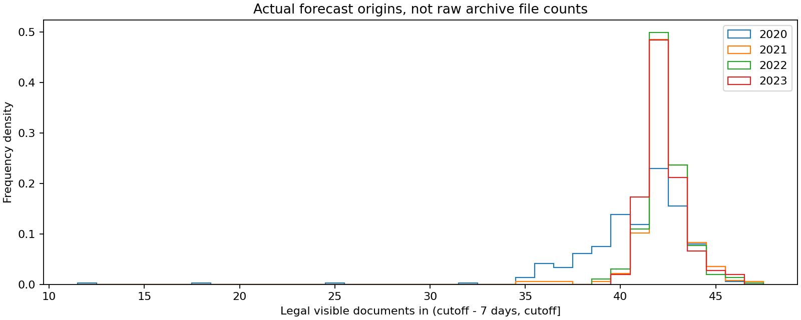
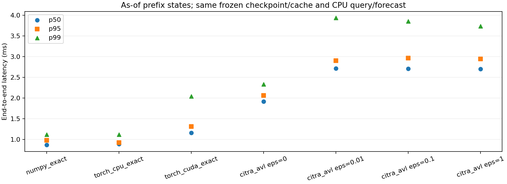
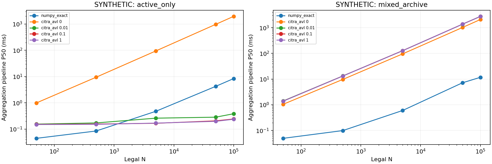
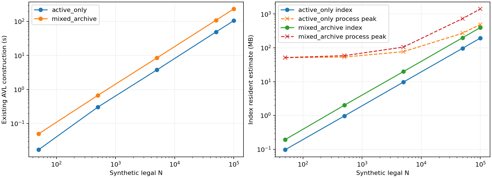

# CITRA 最终系统可行性诊断（2026-10-29）

**System No-Go。** 当前真实七天窗口仅约42篇文档；同算子、同冻结参数、同缓存的强向量化Exact更快。
主表使用**只含cutoff当时已公开记录的前缀库**，不以未来归档造成的额外混合节点惩罚AVL。
另保留完整2020–2023归档回放结果作敏感性分析，不能将该回放的未来树结构成本称作真实在线部署成本。

## 协议与实际集合规模

基线commit `78af29edb21b8b93d795ca6528b1e027273bd40f`，分支 `feature/citra-prototype`。
固定seed7的Window7 Count Mean Residual checkpoint，2020训练、2021验证、2022/2023均为已见诊断；
本系统测量没有使用2024预测结果选查询。每年6个均匀排名起点，共24个真实查询，每法每点10次热调用；
方法顺序按查询/重复循环轮换，不挑选最有利延迟。
2020查询是已拟合模型的回顾性计算，不声称2020在线部署过该模型。

原始发行/观测首次到达尚未获证，仍为issuance_asof_assumption：文本发行+0h、数值观测+1h。
每个cutoff先做权威版本选择，再取公开可用时间在(t−7天,t]的全部合法文档，完整核和除以max(N,1)。
逐查询数量经原始snapshot独立核对，不以七天ZIP产品文件数代替合法N。
|年份|实际起点|均值 / 标准差|P50 / P95 / P99 / Max|空窗口比例|
|---|---|---|---|---|
|2020|361|40.845 / 3.170|42 / 44 / 45 / 46|0.00%|
|2021|363|42.309 / 1.382|42 / 44 / 46 / 47|0.00%|
|2022|363|42.314 / 1.114|42 / 44 / 46 / 47|0.00%|
|2023|364|42.291 / 1.093|42 / 44 / 46 / 46|0.00%|

总计1451个日频预测起点，N均值41.941、P95=44、最大47。
源语料8766个保留文档版本；不确定修订/冲突在准备阶段隔离，不能据“已保留数据的版本过滤前后相同”宣称档案不存在修订。
2020初始查询没有2019年归档，最小N=12来自语料左边界，不能解释为覆盖完整七天的典型产品量；该边界查询保留，没有为了负结论删除。
CSV分别记录可访问候选、版本选择后的全历史数量、窗口前后数量、元数据候选行和Exact Key读取数。
Exact只对合法N个Key/Impact计算核；筛选缓存仍会检查当前前缀的元数据数组，二者不是同一“扫描数”。
[逐查询数量CSV](../artifacts/citra_final_diagnosis/system/document_counts.csv)、[数量JSON](../artifacts/citra_final_diagnosis/system/document_counts.json)。

## 同条件强Exact与AVL

共享实际冻结float64 Key/Impact字节和时间/版本元数据缓存；Exact与AVL均不在线重做MiniLM或Key/Impact编码。
所有方法的Query Encoder、数值骨干和最终修正在CPU；CUDA方法**只卸载聚合**，输入query/索引和输出聚合传输均计时并同步。
这使各方法使用逐元素相同的查询、表示和输出形状[1,6,2]，不是不同GPU神经模型的比较，也不是新的Hybrid Index。
独立exact_oracle在正常计时之外核对全部方法、每次运行的输出；不把Top-K或全历史Sum当成当前Exact。
|方法 / 输出ε|端到端P50(ms)|P95|P99|Max|聚合或树查询P50(ms)|
|---|---|---|---|---|---|
|numpy_exact|0.864|0.975|1.114|1.588|0.035|
|torch_cpu_exact|0.885|0.926|1.117|1.172|0.062|
|torch_cuda_exact|1.161|1.311|2.042|2.491|0.151|
|citra_avl / 0|1.920|2.060|2.335|2.597|1.099|
|citra_avl / 0.01|2.715|2.906|3.940|11.215|1.882|
|citra_avl / 0.1|2.707|2.965|3.854|11.245|1.868|
|citra_avl / 1|2.703|2.944|3.741|12.040|1.871|

ε=.1的AVL端到端P50为NumPy Exact的约3.13倍。ε=0并不加速。
背景中的旧1.223ms来自全历史Full的端到端表，不能与本轮纯聚合0.035ms直接相除；本轮结论只取同算子同环境的表内比较。
冷调用单独记录（初始化之后的首次调用，不是全新OS进程/冷磁盘）；每个查询有2次不进入热分位数的预热，预热成本单列。
独立Oracle验证已先触达Query/Forecast和部分算子，所以cold只指首个被测方法调用，不是完全未预热的网络/BLAS；没有声称测得独立进程冷启动尾延迟。
输入历史处理、模型字节校验、时间过滤、Query Encoding、gather/转换、H2D/D2H、聚合、预测修正与最终输出均逐次保存。
数据访问、共享模型保护开销没有只加给某一个方法；CSV可重算P50/P95/P99/Max。
NumPy聚合列不含另列的gather/时间过滤，AVL树查询列包含遍历/检查/聚合，完整成本比较应看端到端列；不把它们当作相同纯算术核。
没有并行GPU训练，但数据收集短暂重叠第二遍测量，且不是独占机器；采用轮换顺序和原始极值保留，而非声称严格硬件隔离。
[主表完整分项JSON](../artifacts/citra_final_diagnosis/system_asof/summary.json)、[逐次CSV](../artifacts/citra_final_diagnosis/system_asof/query_records.csv)。

## 扫描、时间混合和认证预算

ε约束标准化单样本全部horizon/target的**输出L2差**，不是MSE。
归一分母与独立Oracle相同；由实际||W||F换算原始核和预算ε·N/||W||F，归一聚合界再传到预测输出。
这些是float64容差验证的解析余项保证，非形式化IEEE总舍入误差证明。
|ε|平均查询扫描比|按文档加权扫描比|访问节点均值|完全合法节点均值|时间混合节点均值|误差细化总数|全精确退化次数/240|最大误差/最大界|
|---|---|---|---|---|---|---|---|---|
|0|100.00%|100.00%|328.0|0.1|202.2|0|240|0 / 0|
|0.01|95.83%|98.79%|327.9|0.0|202.2|0|230|2.57102e-05 / 0.00041943|
|0.1|95.83%|98.79%|327.9|0.0|202.2|0|230|2.57102e-05 / 0.00041943|
|1|95.83%|98.79%|327.9|0.0|202.2|0|230|2.57102e-05 / 0.00041943|

时间混合节点不能直接使用摘要，必须下钻；混合叶的元数据检查和逐点计算单独有计数。
宽预算下仍几乎全扫描，误差界细化为0，故本工作负载不能把代价主要归因于“界太紧”。
树遍历/叶级fsum与函数调用的组合远高于几十篇文档的批量矩阵计算，与Python执行开销一致；
但没有原生实现受控消融，不能给出“Python独占多少百分比”的已证实归因。
少量早期查询库内全部文档合法时可用摘要，不代表典型长期归档查询已显著省扫描。
本次唯一明显省扫描的查询就是左边界前缀；因此同时报告按文档加权比例，避免小N边界把平均省读夸大。

完整2020–2023回放库（含相对旧cutoff的未来记录，但答案严格过滤）NumPy/AVL(.1)的P50为
0.914/23.225ms。
该更慢的树结果保留在[原始回放](../artifacts/citra_final_diagnosis/system/summary.json)，最终结论以不含未来记录的前缀测量为主，避免不公平夸大AVL缺点。

## 离线构建、维护与内存

24个历史前缀状态分别离线建库再重复查询，不把逐cutoff建库隐藏在热查询之外后声称总成本为零。
索引构建范围0.0022–6.9261秒，
合计78.714秒；这是诊断各历史状态的成本，不是已优化的生产增量部署吞吐量。
100条真实档案的发行时间假设到达序重放，维护总耗时0.0925秒，P50/P95=0.896/1.117ms；
纯索引部分0.0890秒，前缀初始化另外计费。冻结文档向量已提供，不含持续MiniLM/模型更新成本；
该保留数据没有可靠实际修订到达样本，不能把追加维护成本冒充修订传播的完整实测。
|内存指标|MB (10^6 bytes)|范围|
|---|---|---|
|最大前缀索引resident估算|19.811|Python/NumPy去重递归估算|
|完整语料编码Key/Impact数组|1.122|共享表示；不含原文/基础384维输入|
|主测量进程RSS|1354.334|含数据、模型、解释器、各方法缓存和索引|
|主测量进程峰值RSS|1354.334|整个共享测量进程，不能当作单方法峰值|
|含维护scratch的进程峰值|1358.529|额外诊断副本，非单个生产索引|
|CUDA allocator峰值allocated/reserved|1.654 / 2.097|不含完整驱动/context内存|

没有在在线计时时开启tracemalloc来不对称拖慢Python树。RSS阶段值和索引resident定义不同，不把二者混为“Exact内存与AVL内存”的直接差。
[维护逐次记录](../artifacts/citra_final_diagnosis/system_asof/maintenance.json)与主摘要保存构建/转换/cache/模型保护分项。

## 受控规模检查（明确为synthetic）

从冻结模型的2020 Key/Impact联合均值/协方差生成连续联合高斯样本，Key重新归一化；不复制相同向量冒充真实分布。
query取固定2021真实历史，预测修正W使用同一实际参数。
active_only为全部N合法、时间同质的乐观场景；mixed_archive含N合法、约N过期/未来记录和5%旧修订。
每个N/场景独立进程，现有AVL逐条构建，无Hybrid/C++/CUDA重写。每法3个query×3次热计时；冷调用保留。
规模实验每法仅9个热样本，P95/P99为这9次的经验分位数，不是生产尾延迟保证。
这里计“时间过滤+聚合+实际线性修正”，query表示预先给定，不是完整神经预测的端到端速度。
高斯矩和人为版本/时间分布不能代表真实天气归档或真实修订机制，mixed也不是实证的最坏/最好界。
|合成场景|合法N|物理版本数|Exact P50(ms)|AVL(.1) P50(ms)|扫描比|建树秒|索引MB|进程峰值MB|
|---|---|---|---|---|---|---|---|---|
|active_only|50|50|0.044|0.150|0.0%|0.017|0.10|51.12|
|active_only|500|500|0.084|0.155|0.0%|0.300|0.96|53.41|
|active_only|5000|5000|0.475|0.166|0.0%|3.746|9.71|77.05|
|active_only|50000|50000|4.230|0.205|0.0%|48.912|96.98|271.38|
|active_only|100000|100000|8.394|0.242|0.0%|105.150|194.52|490.23|
|mixed_archive|50|102|0.049|1.378|100.0%|0.049|0.19|51.53|
|mixed_archive|500|1025|0.099|13.185|100.0%|0.665|2.00|58.69|
|mixed_archive|5000|10250|0.600|128.001|100.0%|8.422|19.87|105.30|
|mixed_archive|50000|102500|7.166|1369.651|99.9%|108.146|198.97|733.36|
|mixed_archive|100000|205000|11.749|2746.561|100.0%|233.152|398.54|1419.08|

峰值RSS是整个worker的峰值，含样本生成、构建、查询和递归resident估算的临时集合；不是某个算法独占的纯查询峰值。

完成10/10个注册规模/场景组合。全部ε=0/.01/.1/1的P50/P95/P99/Max、实际误差、扫描、维护、峰值RSS和原始逐次JSON保存在[scaling目录](../artifacts/citra_final_diagnosis/scaling)。

在已测网格上，active_only的第一个ε=.1优势出现在N=5000（不等于精确定位了连续交叉点）；N=100000时约34.7倍。仅摊销该次105.15秒构建就至少需要约12,899次保持该优势的查询，还未计维护、内存、时间窗口失效和神经query成本。mixed_archive在已测规模没有此优势，不能把同质场景外推为真实部署加速。

即使时间同质场景出现交叉点，也不能改写System No-Go：真实单站七天只有42篇，没有可信应用需要把此任务扩成数千/数万篇合法同质文本。
mixed归档与同质场景的差异表明交叉点依赖时态分布；合成优势不等于可覆盖真实建库/更新/内存成本。
真实场景Exact本已更快，索引没有可摊销的在线节省。

复现：见最终决策报告的命令；主逐次计时、完整回放、前缀库和合成结果全部保留，没有用Python Full Scan充当唯一Exact。
